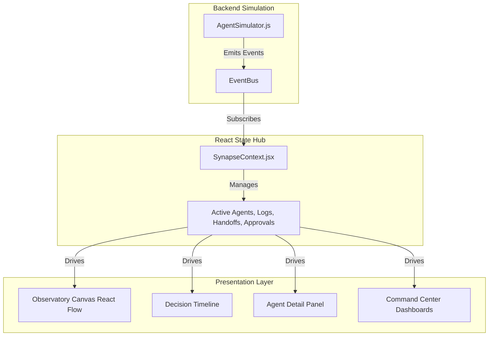

# Synapse Observatory — Product Detail

> [!NOTE]
> **Synapse Observatory** is a next-generation visibility and governance platform designed for the era of autonomous multi-agent systems.

## 1. What It Is
Synapse Observatory is the "Datadog for AI Agents." It is a real-time monitoring, debugging, and governance platform that gives enterprises complete visibility into what their autonomous AI agent swarms are doing. 

As companies move from single-agent chatbots to complex, multi-agent workflows (where agents communicate, negotiate, and delegate tasks to each other), the biggest barrier to enterprise adoption is a "black box" problem. Synapse Observatory cracks open this black box, providing a glass-pane view into agent topologies, communication streams, and decision-making logic.

## 2. What It Does
Synapse Observatory provides a comprehensive suite of tools to monitor and control AI agents:

- **Real-Time Topology Mapping**: Visualizes the entire agent swarm on a dynamic canvas.
- **Inter-Agent Communication Tracing**: Shows exactly when and why one agent hands off work to another, with animated edge connections highlighting data flow.
- **Cost & Token Tracking**: Tracks the granular cost (actions/tokens) of individual micro-agents in real-time.
- **Activity & Decision Logging**: Captures chronological, terminal-style logs of the internal thought processes and actions taken by each agent.
- **Human-in-the-Loop (HITL) Governance**: Pauses autonomous execution when critical thresholds (e.g., high budget approvals) are reached, requiring human sign-off before proceeding.
- **Scenario Replay & Timelines**: Generates horizontal execution timelines to break down how a complex scenario (e.g., self-healing supply chain) was resolved step-by-step.

## 3. How It Is Different
The current AI market is heavily saturated with **Agent Frameworks** (e.g., LangChain, AutoGen, CrewAI) and **Agent Builders** (e.g., Flowise, Voiceflow). 

**Synapse Observatory does not compete in the crowded "builder" space.** 

> [!TIP]
> **The Differentiation:** Instead of helping you *build* an agent, Synapse helps you *trust* the agents you've already built. 

- **Agnostic Layer**: It is designed to sit on top of any backend agent framework as an observability layer.
- **Focus on Governance**: While others focus on making agents smarter, Synapse focuses on making them accountable, traceable, and safe for enterprise deployment.
- **Consumer-Grade UX for Enterprise**: It utilizes a premium, glassmorphic design system with micro-animations that turn abstract code logs into an intuitive, physical-feeling command center.

## 4. How It Works (Technical Architecture)

Synapse Observatory is built as a highly responsive, event-driven frontend application. 

### The Core Engine: `AgentSimulator.js`
At the heart of the demo is a custom-built, event-driven state machine. It simulates a complex backend agent orchestration system without requiring heavy API dependencies.
- It manages an internal state of inventory, pricing, and active agents.
- It emits specific events via a custom EventBus (`activity`, `agent-status`, `agent-handoff`, `approval-added`).
- It executes predefined, highly complex business scenarios (e.g., "Invoice OCR Processing", "Self-Healing Supply Chain") using asynchronous delays to mimic LLM inference times.

### The Visualization Layer: `Observatory.jsx` (React Flow)
The visual representation is powered by React Flow, heavily customized with CSS modules.
- **Nodes**: Custom React components representing agents. They react to state changes (e.g., a glowing pulse animation triggers when status switches to `PROCESSING`).
- **Edges**: Connections between nodes that are dynamically activated by listening to `agent-handoff` events.
- **Context API (`SynapseContext.jsx`)**: Acts as the centralized bridge. It subscribes to the `AgentSimulator` events and broadcasts them to the UI components (Canvas, Timeline, Command Center).

## 5. Use Case Scenarios

The platform currently ships with three demonstration scenarios that prove its enterprise value:

1. **Invoice OCR Processing**
   - *Flow*: `Inventory` → `Procurement` → `Finance`
   - *Value*: Shows how agents handle mundane data entry, triggering alerts only when stock drops below thresholds or budgets require approval.
2. **WhatsApp Custom Order**
   - *Flow*: `Pricing` → `Inventory` → `Logistics`
   - *Value*: Demonstrates omnichannel ingestion, where an unstructured customer request is routed, priced, and scheduled by a swarm of specialized agents.
3. **Self-Healing Supply Chain**
   - *Flow*: External API Alert → `Logistics` → `Pricing` → `Inventory` → `Procurement`
   - *Value*: The flagship demo. A weather API detects a cyclone on a shipping route. Agents autonomously calculate the delay, adjust dynamic pricing for affected SKUs, reserve safety stock, and reroute shipments via a backup supplier — completely autonomously.

## 6. The "Hackathon Winning" Pitch
If presenting this at a hackathon, the core narrative should be:

> *"Everyone here is building AI agents. But if an enterprise deploys an agent swarm that hallucinates, spends $10,000, and breaks a supply chain — who is responsible? You can't deploy what you can't observe. We built Synapse Observatory, the mission control for autonomous agents. We don't build the agents; we provide the observability and governance layer that makes deploying them safe, trackable, and enterprise-ready."*

---

## 7. Connect Your External Agents (NEW)

Any external agent system — Python, Node.js, LangChain, AutoGen, CrewAI, n8n — can send live telemetry to Synapse over HTTP.

### Environment Variables

Add these to .env before starting the server:

| Variable | Required | Description |
|---|---|---|
| SYNAPSE_API_KEYS | Yes | Comma-separated API keys: either key or projectId:key |
| ALLOWED_ORIGINS | Yes | Comma-separated CORS origins (default: http://localhost:5173,http://localhost:3000) |
| DASHBOARD_AUTH_TOKEN | Recommended | Bearer token for operator actions (kill, pause, approvals) |
| DASHBOARD_AUTH_REQUIRED | Optional | Set to 	rue to enforce dashboard token |
| SYNAPSE_VERIFIER_TOKEN | Optional | Token for Tier 3 Verifier receiver |
| SUPABASE_URL | Optional | Persist events to Supabase |
| SUPABASE_KEY | Optional | Supabase service or anon key |

### API Contract

**POST /api/v1/events** (Header: x-synapse-key: <your_key>)

`json
{
  "projectId": "my-app",
  "agentId": "researcher-1",
  "agentName": "Web Researcher",
  "role": "Research Agent",
  "status": "PROCESSING",
  "task": "Scraping financial data",
  "output": "Found 15 articles",
  "model": "gpt-4o",
  "tokensIn": 400,
  "tokensOut": 150,
  "costUsd": 0.003,
  "latencyMs": 120,
  "confidence": 0.97,
  "handoffTo": "analyst-1"
}
`

Response: 202 { ok: true, hrs: 0.04, control: "running" }

**GET /api/v1/agents/:agentId/control?projectId=...** ? { state: "running"|"paused"|"killed" }

**POST /api/v1/approvals** ? Creates approval card in dashboard

**GET /api/v1/health** ? { ok: true, version: "1.0.0" }

**GET /api/v1/agents** ? List all known external agents

### Python SDK

`python
from synapse_sdk import Synapse, AgentKilled

synapse = Synapse(url="http://localhost:4000", api_key="synapse-test-key", project_id="my-app")

# Single event
synapse.report("agent-1", "PROCESSING", task="Analyzing data", tokensIn=400, tokensOut=150)

# Auto-tracked context manager (measures latency, sends COMPLETED or ERROR)
with synapse.track("agent-1", "My Agent", "Research") as t:
    t.set_output("Result text")
    t.set_tokens(400, 150)
    t.set_handoff("next-agent")

# Check if operator paused/killed the agent
state = synapse.check_control("agent-1")  # ? "running" | "paused" | "killed"

# Request human approval
approved = synapse.request_approval("agent-1", "Execute wire transfer", amount=5000)
`

### Run the Fake Agent Test Script

`ash
# Start Synapse backend first
node backend/synapse-observatory/server/index.js

# In another terminal, stream fake agent events
python sdk/python/scripts/fake_agent.py
`

### Run Backend Tests

`ash
node --test test/external-agents.test.js
`

### Run Development Server

`ash
npm run dev
`

This starts both the Express backend (port 4000) and the Vite frontend concurrently.
